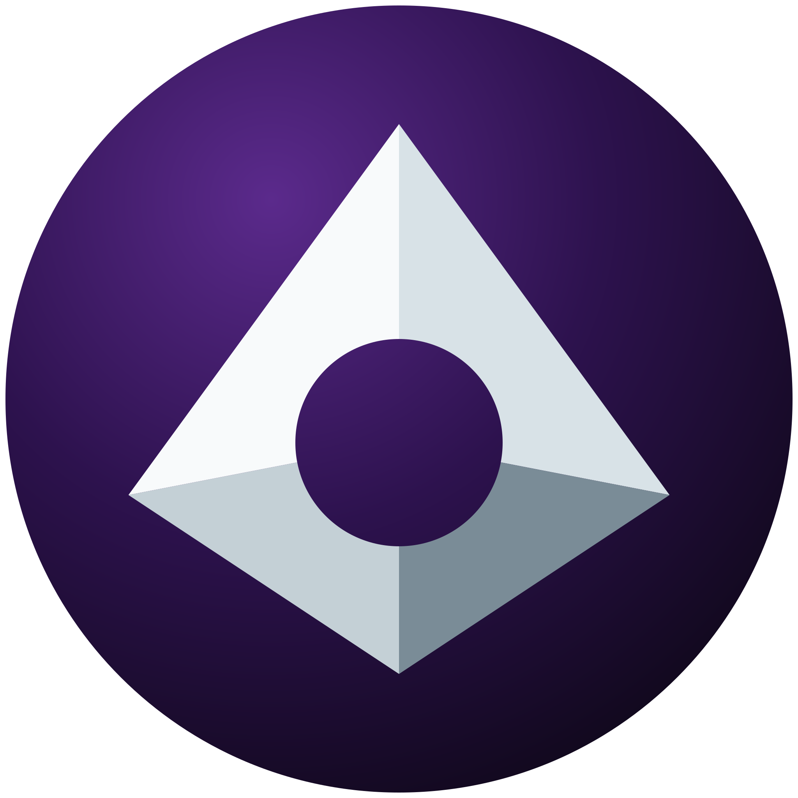
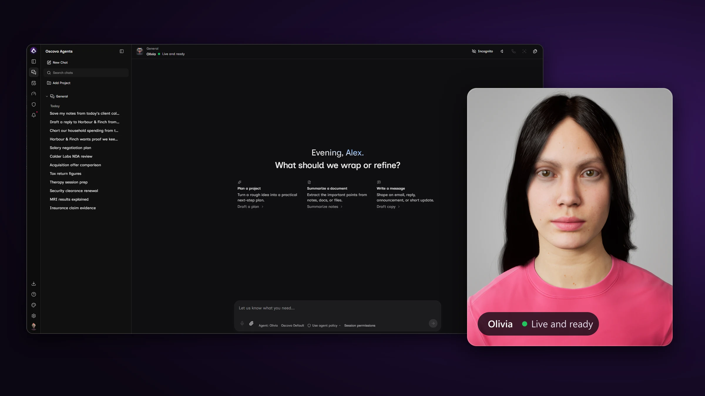

<p align="center">
  
</p>

<h1 align="center">Oscova Agents: Self-Hosted AI Agent OS</h1>

<p align="center">
  <strong>Private AI agents. Encrypted by default.</strong><br />
  For home and office, on hardware you own.
</p>

<p align="center">
  <a href="https://www.nuget.org/packages/Oscova.Agents.App"></a>
  <a href="https://www.nuget.org/packages/Oscova.Agents"></a>
  <a href="LICENSE"></a>
</p>

<p align="center">
  <a href="https://oscova.ai">Website</a> ·
  <a href="https://oscova.ai/docs/">Documentation</a>
</p>

> ⭐ **Star and watch Oscova so you never miss what's new:**
> - **New avatars** for your agent, or for your own app through the Oscova Avatar Engine
> - **New plugins** for channels, tools, speech and models
> - **Framework changes** that plugin builders need to know about
> - **Regular updates** to the agent OS itself



## What is Oscova Agents?

Oscova Agents is a self-hosted AI agent OS that keeps your agents' data encrypted. Chats, memory, instructions and settings are encrypted on disk under a Vault Password only you hold. An Egress Audit shows every call that leaves your machine. The Oscova Avatar Engine gives your agent a realistic 3D avatar that speaks. It runs on hardware you own, at home or in the office, with local models such as Ollama.

Agents run as durable services. They keep working on scheduled tasks while you sleep, answer from any browser on your network, and can put a face in the room through the Oscova Avatar Engine.

- **Confidential by design.** Every agent's chats, tool calls, task runs and memory are encrypted on disk under your Vault Password. Incognito chats never touch disk.
- **Local by default.** Run local models such as Ollama, LLamaSharp and Foundry Local. Cloud providers are opt-in, and the Egress Audit lists every moment data left the machine.
- **No telemetry.** Oscova sends no usage statistics and no crash reports.
- **Token-frugal.** The runtime keeps prompts lean, so small local models still do real work.
- **Yours to edit.** Every system and runtime instruction can be read and changed.
- **One box for the household or office.** Each person gets their own sign-in, agents, tasks and conversations, with roles and per-agent tool control.

## Features

| Area | What you get |
|---|---|
| Models | Ollama, LLamaSharp (GGUF), Microsoft Foundry Local, and opt-in cloud providers |
| Voice | Offline Whisper recognition and Kokoro synthesis, plus optional ElevenLabs and OpenAI speech |
| Avatar | Oscova Avatar Engine: realistic Unreal Engine avatars streamed to any browser on your network, with subtitles |
| Channels | Discord, Telegram and Slack private chats |
| Workspace | Gmail, Google Calendar and YouTube. Outlook mail and Microsoft To Do |
| Tools | Web and news search, a visible browser, MCP servers, skills and file tools |
| Execution | Docker sandboxing and Microsoft MXC operating-system containment for shell commands |
| Automation | Scheduled and triggered tasks, agent templates, notifications |

## Install Oscova on Windows, macOS or Linux

Oscova runs on Windows, macOS and Linux and needs the .NET 10 SDK. The installer offers to install .NET 10 when it is needed. Automatic .NET setup on Linux currently supports Ubuntu 24.04.

**Windows (PowerShell)**

```powershell
irm https://oscova.ai/install.ps1 | iex
```

**macOS and Linux**

```bash
curl -fsSL https://oscova.ai/install.sh | bash
```

Or install the `oscova` CLI directly with .NET:

```bash
dotnet tool install --global Oscova.Agents.App
```

Then start Oscova:

```bash
oscova start
```

The Avatar Engine currently runs on Windows. Install it with `oscova avatar install`. Update Oscova with `dotnet tool update --global Oscova.Agents.App`.

See the [documentation](https://oscova.ai/docs/) for setup, agents, tasks, privacy and administration.

## What is in this repository

The Oscova application, CLI and Avatar Engine are closed source and ship as free binaries. This repository holds the open-source parts under the Apache-2.0 license: the agent framework that Oscova is built on and its official plugins.

| Project | Purpose |
|---|---|
| [Oscova.Agents](src/Oscova.Agents/README.md) | Agent framework and plugin contract, built on the Microsoft Agent Framework |
| [Agent Templates](src/Oscova.Agents.Plugins.AgentTemplates/README.md) | Editable starter agents for research, writing, planning and email |
| [Browser](src/Oscova.Agents.Plugins.Browser/README.md) | Visible browser navigation, page reading and interaction |
| [Discord](src/Oscova.Agents.Plugins.Discord/README.md), [Telegram](src/Oscova.Agents.Plugins.Telegram/README.md), [Slack](src/Oscova.Agents.Plugins.Slack/README.md) | Chat channel transports |
| [Docker](src/Oscova.Agents.Plugins.Docker/README.md) | Docker execution for shell commands |
| [Microsoft MXC](src/Oscova.Agents.Plugins.Mxc/README.md) | Native operating-system containment for shell commands |
| [ElevenLabs](src/Oscova.Agents.Plugins.ElevenLabs/README.md), [OpenAI](src/Oscova.Agents.Plugins.OpenAI/README.md) | Cloud speech recognition and synthesis |
| [Foundry Local](src/Oscova.Agents.Plugins.FoundryLocal/README.md) | Microsoft Foundry Local model discovery and inference |
| [LLamaSharp](src/Oscova.Agents.Plugins.LlamaSharp/README.md) | Local GGUF inference |
| [Local Speech Recognition](src/Oscova.Agents.Plugins.LocalSpeechRecognition/README.md) | Offline Whisper recognition |
| [Local Speech Synthesis](src/Oscova.Agents.Plugins.LocalSpeechSynthesis/README.md) | Offline Kokoro synthesis |
| [Google Workspace](src/Oscova.Agents.Plugins.GoogleWorkspace/README.md) | Gmail, Google Calendar and YouTube tools |
| [Microsoft Graph](src/Oscova.Agents.Plugins.MicrosoftGraph/README.md) | Outlook mail and Microsoft To Do tools |
| [Web](src/Oscova.Agents.Plugins.Web/README.md) | Web and news search |

## Build a .NET plugin

Plugins are NuGet packages that Oscova installs, enables and loads at runtime.

- Start from the [Echo sample plugin](tests/Oscova.Agents.Plugins.Echo/README.md), the smallest complete plugin.
- Follow [Build your first plugin](https://oscova.ai/docs/articles/developer-guide/plugins/first-plugin.html) in the developer guide.
- Preview plugin settings components with [the settings preview sample](samples/Oscova.Agents.PluginSettingsPreview/README.md).

## Build from source

Plugins compile against the `Oscova.Agents` package at the exact version in [Versions.props](Versions.props). That version can be ahead of the one published on NuGet.org, so pack the framework locally first:

```bash
dotnet pack src/Oscova.Agents -c Release -o artifacts/nuget
dotnet build Oscova.Agents.sln -c Release --source artifacts/nuget --source https://api.nuget.org/v3/index.json
```

## Report a bug or request a feature

Open a [new issue](https://github.com/oscova/oscova-agents/issues/new/choose) and choose **Bug report** or **Feature request**. Each form asks for what we need, such as your Oscova version (`oscova version`), operating system and the steps to reproduce. Bugs and ideas for the closed-source application, CLI and Avatar Engine are welcome here too.

Pull requests are limited to maintainers. If you would like to contribute a change, open an issue to discuss it first.

## Security

Please report vulnerabilities privately. See [SECURITY.md](SECURITY.md).

## License

The code in this repository is licensed under [Apache-2.0](LICENSE). The Oscova application, CLI and Avatar Engine are distributed separately as binaries.
