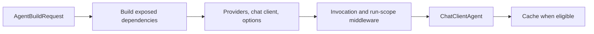

# Agent runtime

The reusable runtime turns an `AgentDefinition` plus host-supplied model, context, workspace, and middleware factories into a Microsoft Agent Framework `ChatClientAgent`. Use this boundary when embedding `Oscova.Agents` in a host. UI settings, persisted user data, and model-provider selection remain host responsibilities.

The supported entry points are IAgentOrchestrator, its default AgentOrchestrator, and AgentBuildRequest.

> **Note:**
> The orchestrator builds and caches agents. It does not own the conversation transport or start a run by itself. Call the returned agent through Microsoft Agent Framework `RunAsync` or `RunStreamingAsync`.

## Supply a build request

`AgentBuildRequest` carries the complete host-to-runtime contract:

| Member | Required | Runtime behavior |
| --- | --- | --- |
| `ChatClientFactory` | Yes | Creates the model-backed `IChatClient` for each definition that must be built. |
| `AgentDefinition` | Yes | Identifies the requested agent. Its `Id` is the cache key. |
| `AvailableAgentDefinitions` | Yes | Resolves referenced agents that are both present and marked `IsExposedAsTool`. |
| `ContextProviderFactory` | Yes | Returns the ordered, non-null `AIContextProvider` list for each built definition. Return `[]` when none apply. |
| `WorkspaceResolver` | Yes | Returns the current allowed directories for each definition when runtime middleware needs them. |
| `ConfigureBuilder` | No | Adjusts the chat-client builder for the requested agent only. Its presence bypasses requested-agent cache reuse. |
| `ConfigureOptions` | No | Adjusts `ChatClientAgentOptions` for the requested agent only. Its presence bypasses requested-agent cache reuse. |
| `BypassRequestedAgentCache` | No | Defaults to `false`. Set it to `true` to build a fresh requested agent without replacing an existing cached one. |
| `ChatReducerFactory` | No | Creates a reducer only when the definition enables compaction. A null factory uses Oscova's summarizing reducer. A factory may return null to omit a custom reducer. |
| `ConfigureAgentBuilder` | No | Adjusts every built agent, including exposed dependencies. Its presence rebuilds and replaces exposed dependencies for the request. |
| `ConfigureHarnessBuilder` | No | Adds standing host middleware to every built agent after the customizers above. Its presence does not bypass cache reuse. |
| `ChatOptionsResolver` | No | Supplies per-definition default `ChatOptions`. The runtime clones the result before assigning it. |

The required callbacks have non-nullable contracts. A null callback fails when invoked, and a null provider list violates the request contract. Return `[]` explicitly when no providers apply.

## Follow the build sequence

For a cache miss, `GetOrCreateAgentAsync` performs these steps:

1. Walk the requested definition's `AgentToolIds`.
2. Build each currently visible exposed dependency before its parent. Nested dependencies are depth-first, and a per-build guard stops cycles from recursing forever.
3. Call `ContextProviderFactory`, then `ChatClientFactory`, for the definition being built.
4. Create `ChatClientAgentOptions` with the definition's ID, name, description, ordered providers, and cloned default `ChatOptions`.
5. Attach an in-memory history provider. Include its reducer when compaction is enabled and reducer creation returns a value.
6. Apply `ConfigureOptions` to the requested agent.
7. Build one governed function-invocation client, then compose workspace validation, every-agent builder customization, requested-agent builder customization, standing harness middleware, and the optional `IAgentRunScopeFactory`.
8. Call `BuildAIAgent`, then cache or return the result according to the request.



The runtime configures its single function-invocation client with:

- `MaximumIterationsPerRequest = 40`.
- `MaximumConsecutiveErrorsPerRequest = 3`.
- `IncludeDetailedErrors = false`.

Detailed tool exceptions therefore stay out of model-visible failure text. Application code can still inspect framework result content and runtime diagnostics.

## Build a minimal agent

This helper builds one definition with its standing instruction and no tools or workspaces. A real host normally resolves a distinct chat client, provider list, and workspace list for every definition.

```csharp
using Microsoft.Agents.AI;
using Microsoft.Extensions.AI;
using Oscova.Agents.Definitions;
using Oscova.Agents.Providers;
using Oscova.Agents.Runtime;

static Task<ChatClientAgent> BuildAgentAsync(
    IAgentOrchestrator orchestrator,
    IChatClient chatClient,
    AgentDefinition definition,
    CancellationToken cancellationToken = default)
{
    var request = new AgentBuildRequest(
        ChatClientFactory: (_, _) => Task.FromResult(chatClient),
        AgentDefinition: definition,
        AvailableAgentDefinitions: [definition],
        ContextProviderFactory: (current, _) =>
            Task.FromResult<IReadOnlyList<AIContextProvider>>(
            [
                new AgentPersonalContextProvider(
                    current.SystemInstruction,
                    _ => Task.FromResult<object>(new { }))
            ]),
        WorkspaceResolver: _ => []);

    return orchestrator.GetOrCreateAgentAsync(request, cancellationToken);
}
```

If the instruction uses Scriban variables, provide them through the `AgentPersonalContextProvider` model factory instead of the empty model in this minimal example.

## Observe a task run

Use AgentTaskRunObserver to project model activity into an AgentTaskRun. The observer is stateful, so create one instance for each run. Initialize `AgentTaskRun.LiveMessages`, assign the observer to an AgentRunObserverAccessor before execution, and clear the accessor afterward.

For each request, the observer ignores every history-attributed message before inspecting its contents. It captures the first ordinary current-run user message and retains the first non-empty assembled instruction. An entire tool-result message is appended when it contains at least one unseen non-null `CallId` or any null `CallId`. A message containing only already-seen non-null IDs is skipped. For non-streaming calls, every response message is appended after the response returns.

`AgentTaskRun.LiveMessagesChanged` runs synchronously on the invoking thread after eligible request messages are appended and after each non-streaming response is observed. Callers own thread marshalling, and subscriber exceptions propagate to the observer caller.

> **Note:**
> AgentRunObserverMiddleware observes requests in both streaming and non-streaming calls. Only non-streaming responses invoke `OnResponse`. Streaming response deltas are not appended by `AgentTaskRunObserver`, and they do not raise a response-side `LiveMessagesChanged` signal.

This helper shows the complete non-streaming lifecycle using the public runtime types:

```csharp
using Microsoft.Agents.AI;
using Microsoft.Extensions.AI;
using Oscova.Agents.Definitions;
using Oscova.Agents.Middleware;
using Oscova.Agents.Runtime;
using Oscova.Agents.Tasks;
using System;
using System.Collections.Generic;
using System.Threading;
using System.Threading.Tasks;

static async Task<AgentTaskRun> RunObservedAsync(
    IAgentOrchestrator orchestrator,
    IChatClient chatClient,
    AgentDefinition definition,
    string instruction,
    CancellationToken cancellationToken = default)
{
    var run = new AgentTaskRun { LiveMessages = [] };
    var observerAccessor = new AgentRunObserverAccessor
    {
        Observer = new AgentTaskRunObserver(run)
    };
    Func<ChatClientBuilder, ChatClientBuilder> configureBuilder =
        builder => builder.UseAgentRunObserver(observerAccessor);

    var request = new AgentBuildRequest(
        ChatClientFactory: (_, _) => Task.FromResult(chatClient),
        AgentDefinition: definition,
        AvailableAgentDefinitions: [definition],
        ContextProviderFactory: (_, _) =>
            Task.FromResult<IReadOnlyList<AIContextProvider>>([]),
        WorkspaceResolver: _ => [],
        ConfigureBuilder: configureBuilder);

    try
    {
        var agent = await orchestrator.GetOrCreateAgentAsync(request, cancellationToken);
        await agent.RunAsync(instruction, cancellationToken: cancellationToken);
        return run;
    }
    finally
    {
        observerAccessor.Observer = null;
    }
}
```

The observer only projects task-run inspection state. The embedding executor still owns execution, persistence, UI presentation, notifications, and hosted lifetime.

## Understand cache and refresh behavior

A requested agent is reused by ID only when all of these are true:

- the definition is not itself exposed as a tool.
- `ConfigureBuilder`, `ConfigureOptions`, and `ConfigureAgentBuilder` are all null.
- `BypassRequestedAgentCache` is `false`.

A cache hit returns before invoking the chat-client, provider, reducer, or workspace factories. Changes behind those factories therefore require explicit invalidation unless the request already bypasses reuse.

Use the narrowest refresh operation:

- `EvictAgent(agentId)` removes one cached agent.
- `InvalidateAllAgents()` clears cached agents but preserves the synchronized tool catalogue.
- `InvalidateAll()` clears both agents and tools.
- `SyncTools(...)` atomically replaces the tool catalogue but does not clear the agent cache.

Builds through one orchestrator are serialized so exposed-dependency replacement and the parent's provider capture stay together. `AIAgentCollection.GetOrAdd` makes concurrent cache misses converge on one cached instance, but a caller that missed before waiting may still execute build factories after the earlier build finishes. Keep factories repeatable and free of one-time side effects.

`ConfigureHarnessBuilder` is intended for standing middleware, such as the host's tool-failure handling. A cache hit does not run it again. Changing that callback or its captured policy requires invalidation just like changing other cached dependencies.

`AgentAsToolProvider` captures the exposed agents available when that provider is created. Rebuild the caller after changing its referenced agents or their definitions.

## Handle cancellation and errors

The cancellation token passed to `GetOrCreateAgentAsync` flows through exposed-dependency builds, context-provider creation, chat-client creation, and reducer creation. A cache hit has no asynchronous build work to cancel.

The build token is separate from the token used later with `RunAsync` or `RunStreamingAsync`. The run token flows through context providers, the chat client, and tool invocation. Cancelling or evicting an agent does not implicitly perform the other action:

- cancelling a run does not remove its built agent from the cache.
- evicting or invalidating an agent does not cancel a run already using that instance.

Factory, reducer, option, builder, and framework construction exceptions propagate to the caller. No newly failed requested instance is cached. An exposed dependency that finished successfully before a later parent failure can remain cached.

## Own disposable resources explicitly

`AgentOrchestrator`, `AIAgentCollection`, and `ChatClientAgent` do not provide an orchestrator-level disposal callback for factory outputs. Cache eviction removes references. It does not call `Dispose` on chat clients or context providers.

Prefer host-managed `IChatClient`, service, and provider dependencies whose lifetime is at least as long as the built agent. Do not allocate a new owned disposable inside a build factory and assume eviction will release it.

## Troubleshoot runtime builds

- **A saved change is missing:** evict the affected agent or bypass requested-agent cache reuse.
- **An agent tool is absent:** confirm the referenced ID is in `AvailableAgentDefinitions`, is marked `IsExposedAsTool`, and the caller was rebuilt.
- **A customizer did not affect a child:** use `ConfigureAgentBuilder`. `ConfigureBuilder` and `ConfigureOptions` apply only to the requested agent.
- **A build runs more than once:** concurrent cache misses may execute factories more than once even though callers receive one cached instance.
- **A tool loop stops early:** check the three-error limit, host-supplied failure handling, governance denial, and the original application-side exception.
- **A new provider fails agent construction:** check for null entries and duplicate provider `StateKeys`.

## Related articles

- [Context Providers](references/developer-guide-runtime-context-providers.md)
- [Runtime Hooks](references/developer-guide-runtime-hooks.md)
- [Agent as Tool](references/developer-guide-runtime-agent-as-tool.md)
- [Toolsets](references/developer-guide-toolsets-toolsets.md)
- [Tool Policies](references/developer-guide-governance-tool-policies.md)
